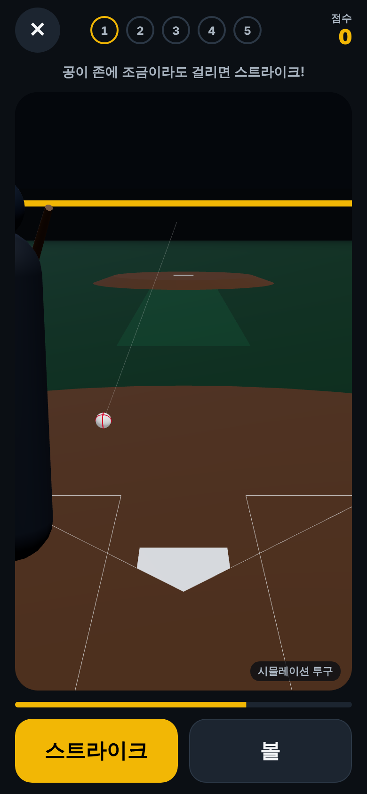
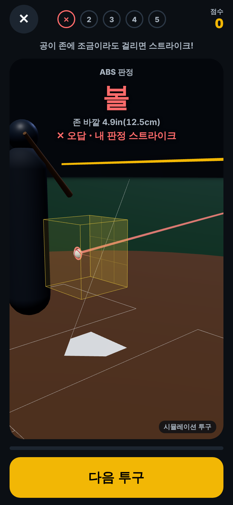
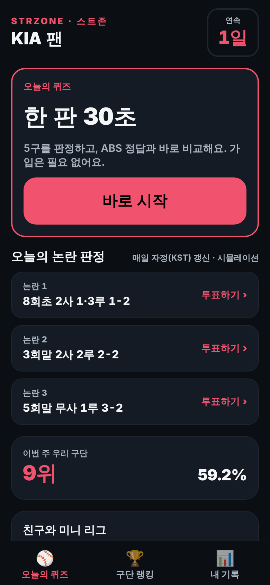
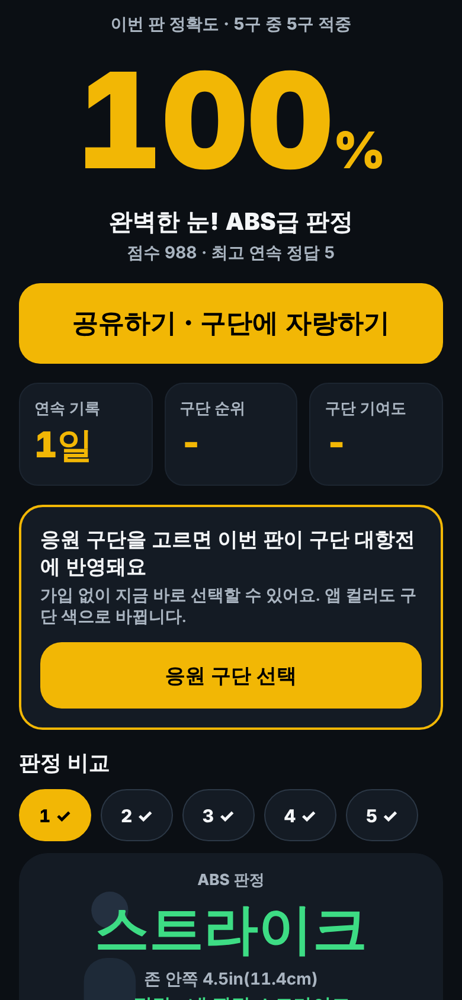
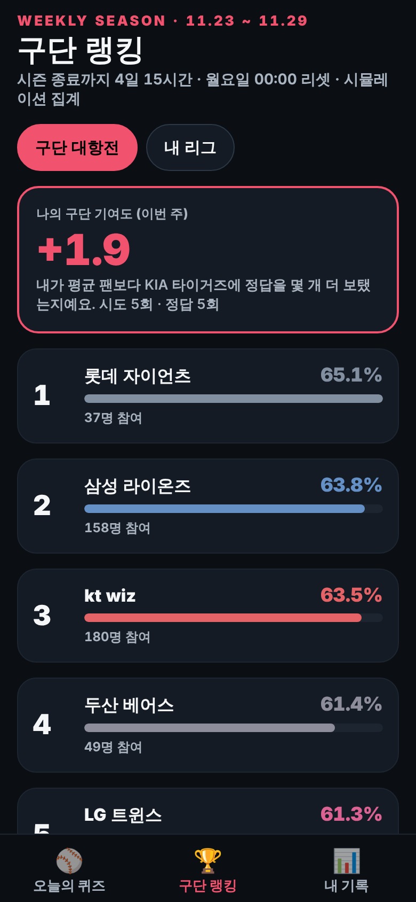
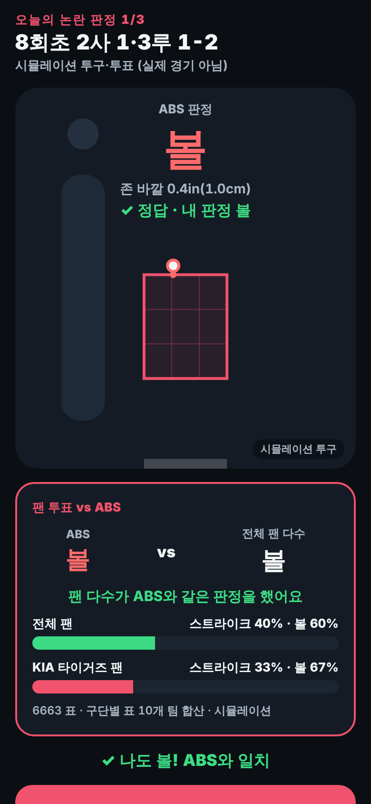

# 스트존 (STRZONE) — KBO 팬 소셜 판정 앱 MVP

> **"우리 구단 팬이 심판보다 정확하다"** — 볼/스트라이크 판정 맞히기 + 구단 대항전
> 타깃: 10~30대 KBO 팬 · 크로스플랫폼(Expo/React Native) · 한국어 · 금전 보상/베팅 없음

기존 솔로형 판정 게임(인간 ABS)과 겹치지 않도록 **판정 모드는 볼/스트라이크 하나만** 두고, 재미의 축을 *개인 숙련 → 집단 소속감*으로 옮겼습니다.

| 차별화 | 구현 |
|---|---|
| ① 구단 대항전 | 응원 구단 선택(가입 없이) → 구단별 정확도 **주간 시즌(월 00:00 KST 리셋)** 순위, 개인 캡 + 베이지안 수축으로 공정성 확보 |
| ② 오늘의 논란 판정 | 하루 3개 경계선 투구, **팬 투표 vs ABS** 공개(전체 / 내 구단) |
| ③ 공유 카드 | 정확도·스트릭·구단 기여도 1장, **스토리 9:16 / 카톡 1:1**, 논란 판정 카드 + 5초 클립 자동 생성 |
| ④ 미니 리그 | 초대 링크 하나로 생성, 링크 받은 친구는 **가입 없이** 참여 |

**3D 판정 스테이지**: 마운드에서 물리 궤적(중력 + 구종 변화)으로 날아오는 공을 주심 시점에서 판정 → 공개 시 카메라가 1루 쪽으로 돌며 3D 존 박스와 궤적이 드러납니다(three.js / react-three-fiber, iOS·Android는 expo-gl). WebGL이 없거나 설정에서 끄면 2D로 자동 전환.

| 3D: 판정(주심 시점) | 3D: 공개(리플레이 시점) |
|---|---|
|  |  |

| 오늘의 퀴즈 | 결과 + 공유 | 구단 랭킹 | 논란 판정(2D) |
|---|---|---|---|
|  |  |  |  |

공유 카드 샘플(실제 생성물): [스토리](docs/samples/round-story.png) · [카톡](docs/samples/round-square.png) · [논란 판정](docs/samples/controversy-story.png) · [클립 mp4](docs/samples/controversy-clip.mp4)

## 문서 (요청한 산출물 5종)
1. [차별화 포인트 표](docs/01-differentiation.md)
2. [사용자 흐름 3개 · 화면 목록](docs/02-flows-screens.md)
3. [데이터 설계 — 투구 데이터 · 점수식 · 구단 랭킹 집계](docs/03-data-design.md) · SQL: [`supabase/schema.sql`](supabase/schema.sql)
4. [핵심 화면 코드 안내(퀴즈 · 결과 비교 · 공유 카드)](docs/04-code-guide.md)
5. [개막 전 로드맵 · 성공/실패 기준](docs/05-roadmap-kpi.md)
+ [가정 · 리스크 · 열린 질문](docs/06-assumptions-risks.md)

## 실행
```bash
npm install
npm start          # Expo. 서버 없이 MockApi(시뮬레이션)로 동작
npm test           # 단위 테스트 37개
npm run typecheck
npm run verify:sql # (로컬 PostgreSQL 16) schema.sql ↔ TS 로직 대조 검증
```

## 검증 현황
- ✅ 단위 테스트 37개(3D 궤적: 정답 좌표 도착·비행시간·지면 위 포함), `tsc`, 웹 번들, 헤드리스 브라우저 E2E(첫 실행→5구→결과→공유→구단 선택→탭→논란 판정, 3D WebGL 렌더 포함), **PostgreSQL에서 SQL↔TS 15개 항목 일치**
- ❌ **iOS/Android 실기기 미검증**(3D의 expo-gl 렌더·성능, 햅틱·로컬 알림·이미지 공유 시트·딥링크), **서버 미연동**(앱은 `MockApi`). 자세한 표: [docs/04](docs/04-code-guide.md#4-5-검증한-것--못-한-것-정직하게)
- 투구·투표 데이터는 **전부 시뮬레이션**이며 화면/카드에 상시 고지됩니다. 실데이터는 라이선스 확보 후 `source='licensed'`로 교체합니다.
